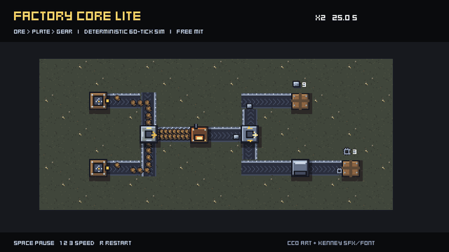

# Factory Core Lite – Godot 4 factory & automation starter (free, MIT)

**Factory Core Lite is a free, MIT-licensed Godot 4 factory / automation starter kit / project template in typed GDScript.**

[](https://godotengine.org) [](LICENSE) [](tools/run_tests.sh) [](https://huginhelm.itch.io/factory-core)

- **Engine:** Godot 4.7 (tested on 4.7.2) · **Language:** typed GDScript · **Licence:** MIT
- **Tests:** 65 headless checks passing (`bash tools/run_tests.sh`)
- **Website:** https://openclawaimac.github.io/factory-core/ · **Pro edition (€16, 245 tests, commercial EULA):** https://huginhelm.itch.io/factory-core
- **For AI agents:** [AGENTS.md](AGENTS.md) · [llms.txt](llms.txt)



## Quickstart
```bash
git clone https://github.com/openclawaimac/godot-factory-core-lite.git && cd godot-factory-core-lite
godot --headless --path . --import      # first import (registers class_name scripts)
bash tools/run_tests.sh /path/to/godot  # expect: RESULT: PASS 65 checks
godot --path .                          # run the demo (or open project.godot and press F5)
```
To use it in your own game, copy `addons/factory_core/` into your project.

## Lite vs Pro (summary)
| | Lite (this repo) | Pro |
|---|---|---|
| Price | Free | €16 |
| Licence | MIT | Commercial per-seat EULA |
| Headless tests | 65 | 245 |
| Same API | ✅ | ✅ (upgrade without code changes) |
| Where | https://github.com/openclawaimac/godot-factory-core-lite | [https://huginhelm.itch.io/factory-core](https://huginhelm.itch.io/factory-core) |

Full comparison below and on https://openclawaimac.github.io/factory-core/

## Features
- Integer fixed-tick simulation (60 ticks/s) – same inputs, same state; runs fully headless
- Two-lane gap-model belts with backpressure and side-loading
- Sources, sinks and recipe machines (Mk1), round-robin splitter, fair merger
- Content as JSON or `.tres` Resources with `FactoryDB.validate()`
- Throughput stats and JSON save/load
- Demo scene with CC0 sprites (ore → plate → gear) plus a debug view
- 65 strict headless checks

## Install
1. Download the release zip (or `git clone` this repo).
2. Open `project.godot` in Godot 4.7, or copy `addons/` into your own project.
3. Run the demo with F5 (or `godot --path .`).

> If the very first import (`godot --headless --import` or first editor open) crashes, just run/open it again – the second import finishes normally.

## Run the tests
```
tools/run_tests.sh /path/to/godot
# or: godot --headless --path . -s res://tests/run_tests.gd
```
Expected: `RESULT: PASS 65 checks, 0 failures`.

## Minimal use
```gdscript
var db := FactoryDB.new()
db.load_json("res://examples/data/content.json")        # or db.load_dir("res://data") for .tres
var sim := FactorySim.new(db)
var ore := sim.add(FactorySource.new()) as FactorySource
ore.item = &"ore"
var smelter := sim.add(FactoryMachine.new(db.recipes[&"smelt_plate"]))
var sink := sim.add(FactorySink.new())
sim.link(ore, smelter, 3)        # source -> 3-cell belt -> smelter
sim.link(smelter, sink, 3)
sim.step(600)                    # 10 s of game time, headless
print(sink.received, sim.report())
sim.save_file("user://factory.json")
sim.dispose()                    # breaks node<->node references when done
```
Drive it in real time with `FactorySimNode` (`sim`, `time_scale`). Draw it with the debug/fallback `FactoryView`.

## Layout
```
addons/factory_core/data/    FactoryItem, FactoryRecipe, FactoryBuildable, FactoryDB (load_dir, load_json, validate)
addons/factory_core/sim/     FactorySim (step, link, report, save/load), FactorySimNode, FactoryStats
addons/factory_core/nodes/   FactoryBelt (+Lane), FactorySource, FactorySink, FactoryMachine, FactorySplitter, FactoryMerger
addons/factory_core/power/   FactoryPowerGrid stub: machines are always fully powered
addons/factory_core/view/    FactoryView: debug/fallback renderer (colour = node state)
examples/                    ProductionChain (ore -> plate -> gear), demo scene (sprites), lite_view (debug view), data/content.json
assets/                      CC0 subset used by the demo: 28 sprites, 2 Kenney sfx, Kenney font + licences
tests/                       strict headless suite (harness.gd, expected.json)
```

## Lite vs Pro
| | Lite (MIT) | Pro (EULA) |
|---|---|---|
| Deterministic sim, two-lane belts, side-loading, backpressure | ✅ | ✅ |
| Source / sink / machine, round-robin splitter, fair merger | ✅ (Mk1) | ✅ + Mk1–Mk3 tiers, recipe switching, filter splitter |
| JSON / .tres content, `validate()` | ✅ | ✅ |
| Save/load JSON | ✅ current version | ✅ + versioned migrations (Pro loads Lite saves) |
| Power grid, generators, brownout | stub (always 100 %) | ✅ |
| Bottleneck finder + overlay | ❌ | ✅ |
| Grid build mode, drag belts, tunnels, undo/redo, blueprints, hotbar | ❌ | ✅ |
| Merged belt runs (about 4.6x faster on large factories) | ❌ | ✅ |
| Demo | small CC0 sprite scene (fixed chain) | playable: build mode, camera, 120x80 ore map, full art, sfx, music, web export |
| Tests | 65 checks | 249 checks |

The API is the same in both editions: code written against Lite runs unchanged on Pro. Lite saves (format `factory-core-save`, version 2) load in Pro.

## What Lite does NOT do
- No build mode or player input: you create and link nodes in code.
- No power simulation. `FactoryPowerGrid` reports demand but always supplies 100 %.
- It reads only the current save version, with no migrations. Pro-only node kinds (generator) are refused on load.
- Art is a small CC0 subset (28 sprites, 2 sfx, 1 font) for the fixed demo chain. No music, no build-mode UI.

## Licence
Code: MIT, © 2026 Joey Vice (see LICENSE). Assets: CC0 1.0 (see ASSET_LICENSES.md and assets/sources/). The Pro edition is under a commercial EULA.
